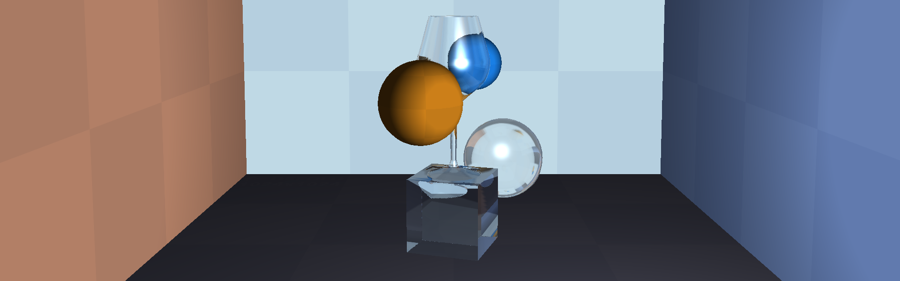
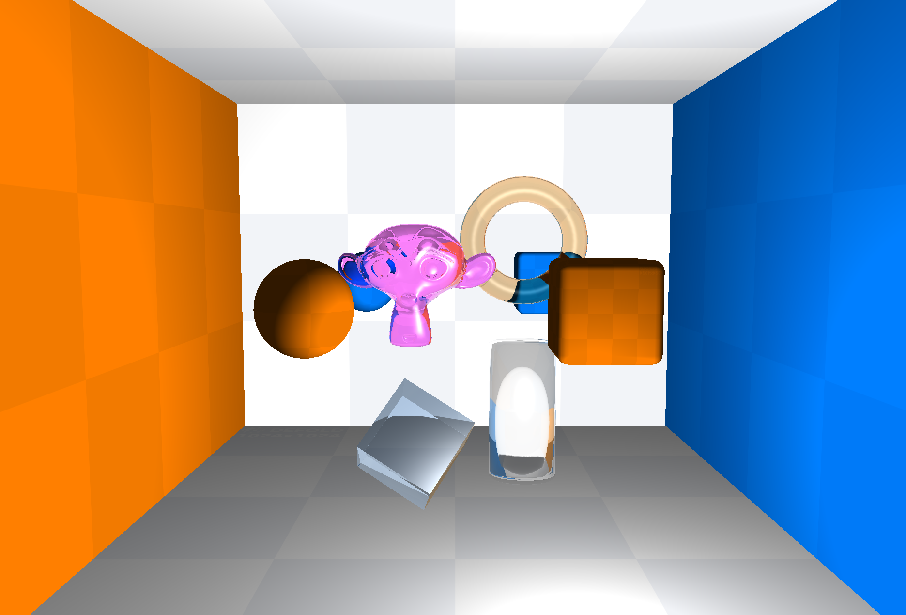
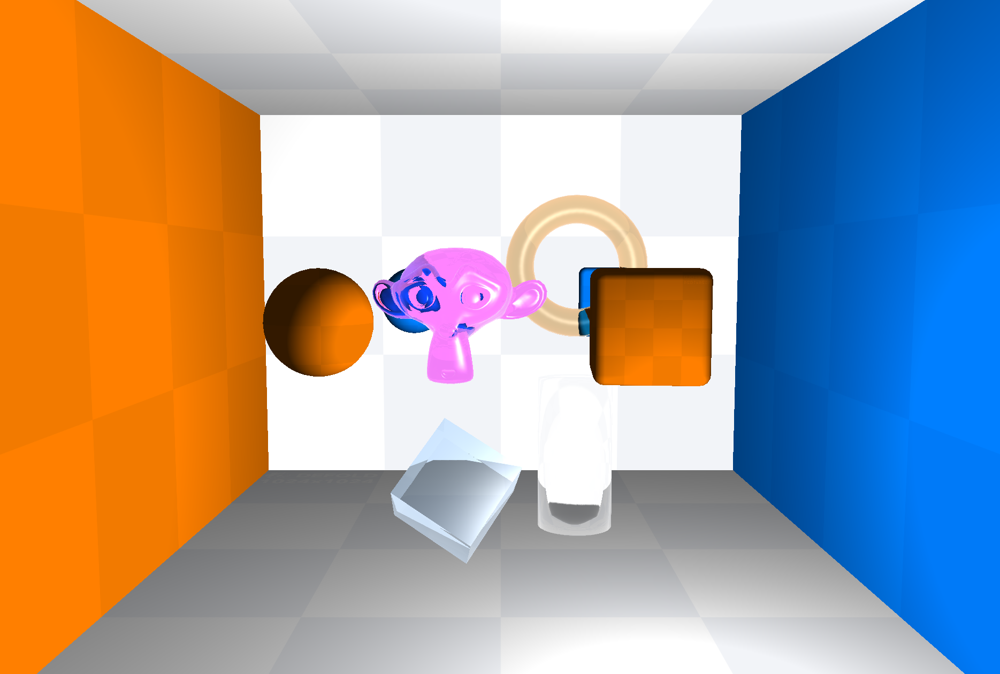
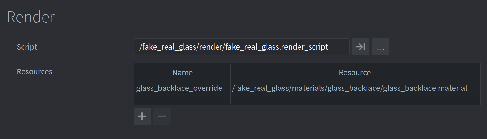
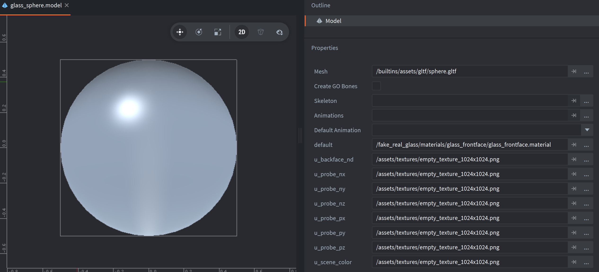

# Fake Real Glass for Defold

A multipass fake glass effect for [Defold](https://defold.com), based on the [UnityURP-FakeRealGlass](https://github.com/Youssef-Afella/UnityURP-FakeRealGlass).



This project reproduces the core ideas from the Unity version:

- screen-space double refraction
- a back-face normals/depth pass
- thickness-based distortion
- optional local probe reflections
- optional absorption
- forward rendering
- a movable specular light
- runtime-configurable reflection probe modes and probe size

The repository includes two example Defold collections.

## Installation

In order to use FakeRealGlass in your Defold game add project as a Defold library dependency. Don't forget to fetch the libraries.

Newest version link:

```
https://github.com/paweljarosz/defold-fake-real-glass/archive/refs/tags/v1.0.zip
```

Once added, you must require the main Lua module in scripts via:

```lua
local fake_real_glass = require("fake_real_glass.fake_real_glass")
```

## Quick Start

The easiest way to integrate this effect into your own project is to:

1. Use the included [fake_real_glass.render](fake_real_glass/render/fake_real_glass.render) with the [fake_real_glass.render_script](fake_real_glass/render/fake_real_glass.render_script)
using the [fake_real_glass.lua](fake_real_glass/render/fake_real_glass.lua) as the reusable render module add-on, or modify your render pipeline to include fake_real_glass add-on (read below).
2. Use the [glass_front.material](fake_real_glass/materials/glass_front.material) on your glass models.
3. Assign the [fake_real_glass.script](fake_real_glass/scripts/fake_real_glass.script) to control parameters of each glass model component.

## Reflection probe modes

The main quality/performance choice is the reflection probe behaviour and here are offered 3 modes:

| Probe mode | Recommendation |
|---|---|
| `every_frame` | Dynamic scenes - gives best quality, as it renders reflection probe each frame, but has highest cost. |
| `capture_once` | Room/area with static objects, it renders reflection probe only once (or on demand, when explictly set again.) |
| `disabled` | Very performance-sensitive scenes, where you can provide pre-rendered cubemap textures, no runtime reflection probe generation, so cheapest. |

Here is the scene with the reflection probe:



Here is the scene without the reflection probe:



## Add it to your own Render Pipeline

If you already have your own render script, the integration is intentionally small and least intrusive, the provided render script just adds the lua module into the default Defold render script. In order to integrate it:

1. Add The Back-Face Material To Your `.render` File:
  
  If you want a different material name, remember to pass it into `fake_real_glass.create({ backface_material = "..." })`.

2. Require the Fake Real Glass module in your render script:
```lua
local fake_real_glass = require "fake_real_glass.render.fake_real_glass"
```

3. Create the glass state in `init()`:
```lua
function init(self)
    self.fake_glass = fake_real_glass.create({
        backface_material = "glass_backface_override",
    })
    fake_real_glass.resize(self.fake_glass, render.get_window_width(), render.get_window_height())
end
```

4. Draw glass after drawing the opaque world in `update()`:
```lua
-- Fake Real Glass integration:
-- this captures the opaque scene/back faces and draws the glass front faces.
fake_real_glass.draw(self.fake_glass, {
    view = world_view,
    projection = world_projection,
    window_width = state.window_width,
    window_height = state.window_height,
    clear_buffers = state.clear_buffers,
    draw_world = function(view, projection, viewport_width, viewport_height)
        draw_world(predicates, view, projection, viewport_width, viewport_height)
    end,
})
```

That one call handles:
- optional 6-face probe capture
- scene color capture to `scene_rt`
- back-face glass capture to `backface_rt`
- final front-face glass rendering to the screen

5. Forward messages to the module in `on_message()`:

```lua
function on_message(self, message_id, message)
    if fake_real_glass.on_message(self.fake_glass, message_id, message) then
        return
    end

    -- your other render-script messages here
end
```

6. Resize the scene render targets on window resize:
```lua
if message_id == MSG_WINDOW_RESIZED then
  update_state(state) --default render script
  fake_real_glass.resize(self.fake_glass, state.window_width, state.window_height)
end
```

7. Clean up in `final()`:

```lua
function final(self)
    fake_real_glass.final(self.fake_glass)
end
```

### Adding a glass material to model

Use [glass_frontface.material](fake_real_glass/materials/glass_frontface.material) on a `.model`.

Each glass `.model` needs placeholder textures for the samplers that will be overridden at runtime.

When the reflection probe is enabled, the render module overrides those six probe textures at runtime.

When the reflection probe is disabled, the material falls back to whatever textures you declared there, so if you can use the prerendered textures, assign them here.

In the editor the material falls back to a built-in preview until the runtime render module binds the real scene and back-face textures, so the model stays visible while editing. This could be removed, but then the preview of the model in the editor would be invisible, beside bounding box.



### Add the helper script

There is a helper [fake_real_glass.script](fake_real_glass/scripts/fake_real_glass.script) to simplify setting up the parameters for the glass model.

By default that helper script targets the model component id `model`.

If one game object contains multiple glass model components, set its `model_id` property to the component id you want that script instance to control.

### Set The Light

Set `light_position` from gameplay code:

```lua
go.set("/my_glass#model", "light_position", vmath.vector4(x, y, z, 64.0))
```

`x`, `y`, `z` are the light world position.

`w` is the specular power.

## Runtime Controls

### Probe Modes

The shared enum lives in [fake_real_glass/render/fake_real_glass.lua](fake_real_glass/render/fake_real_glass.lua):

```lua
local fake_real_glass = require "main.render.fake_real_glass"

fake_real_glass.PROBE_MODE.DISABLED
fake_real_glass.PROBE_MODE.CAPTURE_ONCE
fake_real_glass.PROBE_MODE.EVERY_FRAME
```

### Sending Probe Settings

Send this to `@render:`:

```lua
local fake_real_glass = require "main.render.fake_real_glass"

msg.post("@render:", "set_probe_settings", {
    position = vmath.vector3(0, 3, -1),
    extents = vmath.vector3(4, 3, 4),
    size = 256,
    mode = fake_real_glass.PROBE_MODE.CAPTURE_ONCE,
})
```

Supported fields:

- `position`
  probe center in world space
- `extents`
  half-size of the local probe box
- `size`
  probe face resolution in pixels
- `far`
  optional probe far plane override
- `mode`
  `DISABLED`, `CAPTURE_ONCE`, or `EVERY_FRAME`
- `rebuild`
  forces a new capture in `CAPTURE_ONCE` mode

Changing `size` recreates all six probe render targets.

If probes are currently disabled, the new size is still remembered and will be used next time probes are enabled.

## Probe Modes

This is the biggest quality/performance lever in the whole system. It tells the script how many time the reflection probes are rendered. Each side of the probe (6 of them - a cubemap) is a separate draw call. You can choose not to capture the probes, to capture them once, or every frame:

### `disabled`

- skips the probe target creation and the 6-face probe capture path entirely, leaves the front glass shader using the model's placeholder probe textures

Advantages:

- lowest cost and complexity
- best choice, if you only care about refraction, and do not need proper reflections, or your scene is static and you can create proper placeholder textures for your models

Disadvantages:

- reflections are no longer real, nearby scene objects are not reflected through the probe path, especially visible in dynamic scenes with moving objects

### `capture once`

- renders the 6 probe faces once and then keeps reusing them until you ask for a rebuild

Advantages:

- keeps real scene-based reflections, without setting default textures upfront
- only renders once, so steady-state cost is close to `disabled`
- best default for a mostly static room

Disadvantages:

- reflections become stale if the reflected environment changes
- you need to trigger `rebuild = true` manually, when you care about those changes
- temporarily higher cost on the frame that rebuilds the probe

### `every frame`

- captures all 6 probe faces every frame

Advantages:

- reflects the moving objects correctly, perfect, when you have dynamic scenes

Disadvantages:

- highest draw calls amount and scene redraw cost

## Probe Size

`size` controls the resolution of each of the 6 probe faces. Typically, I use something between `64` for very cheap reflections, and `512` for sharper reflections, but this is noticeably more expensive.

## Tuning Guide

Some tested values:

| Test | Settings |
|---|---|
| Clear glass | `ior=1.45`, white `tint_color`, absorption off |
| Strong room reflections | larger `env_reflection_strength` |
| Dense colored glass | absorption on, stronger `absorption_color`, larger thickness |
| Thin fake crystal | higher `ior`, moderate reflection, lower absorption |
| Frosted / softer reflections | lower `surface_smoothness` |

- if refraction is too weak, increase `refraction_distance`
- if thickness looks weird, try `use_constant_thickness = 1`
- if reflections look detached, make the probe `extents` match the real room better, keep `box_projection_amount=1.0`
- if reflections feel like they come from the wrong place, move the probe center - in fact all glass objects start probing from the same center, so keep them in the similar position for best effect. This could be improved by making multiple separate probes for each glass objects.

## Module API

The reusable render module is [fake_real_glass/render/fake_real_glass.lua](fake_real_glass/render/fake_real_glass.lua).

### Quick API Reference

- `fake_real_glass.create(options)` - creates render targets and settings for the fake real glass effect
- `fake_real_glass.resize(glass, width, height)` - resizes render targets
- `fake_real_glass.draw(glass, params)` - draws the glass objects and all needed textures for reflections and refractions
- `fake_real_glass.on_message(glass, message_id, message)` - handles messages from the glass script
- `fake_real_glass.final(glass)` - clears everything
- `fake_real_glass.PROBE_MODE` - enum for probe modes

### `.create(options)`

Supported options:

- `glass_tag`
  defaults to `"glass"`
- `glass_predicate`
  optional custom predicate if you do not want the default tag-based one
- `backface_material`
  defaults to `"glass_backface_override"`
- `probe_position`
- `probe_extents`
- `probe_size`
- `probe_far`
- `probe_near`
- `probe_mode`
- `probe_max_blur_texels`

### `.draw(glass, params)`

Required params:

- `view`
- `projection`
- `window_width`
- `window_height`
- `clear_buffers`
- `draw_world`

The `draw_world(view, projection, viewport_width, viewport_height)` callback should redraw your normal opaque world for:

- probe capture
- `scene_rt` capture

## What The Effect Does

At a high level, the front glass shader does this:

1. compute the incoming view ray
2. refract that ray at the front surface
3. estimate thickness using the back-face texture
4. find the first internal intersection
5. sample the back-face texture again there
6. refract back out of the glass
7. sample `scene_rt` at the exit point for transmission
8. optionally sample the probe for reflections
9. mix transmission and reflection using Fresnel-style reflectance
10. optionally apply absorption
11. add a direct specular highlight

## Pipeline Overview

In the rendering pipeline there are few passes:

### Pass 0: [Optional] 6-Face Reflection Probe

Only runs when probe mode is `EVERY_FRAME`, or `CAPTURE_ONCE` on request

The module redraws the opaque world 6 times from the probe center.

Output:

- `probe_rts[1..6]` - render targets for each face of the probe

### Pass 1: Opaque Scene To `scene_rt`

The opaque world is redrawn from the main camera into `scene_rt`.

This texture is what the front glass shader samples for refraction.

### Pass 2: Glass Back Faces To `backface_rt`

The module enables the material named `glass_backface_override` and renders the glass predicate with front-face culling.

Output:

- back-face world normal
- back-face view depth

### Pass 3: Glass Front Faces To Screen

The front glass material samples:

- `u_scene_color`
- `u_backface_nd`
- probe faces when probes are enabled

It then computes refraction, reflection, thickness, optional absorption, and the direct specular term.

## Shader Breakdown

### `glass_front.fp`

- split the view ray into reflection and refraction
- reconstruct thickness from back-face depth
- sample refraction through `u_scene_color`
- sample the optional local probe
- apply Fresnel-like weighting
- optionally apply Beer-Lambert-style absorption
- add the direct specular highlight

### `glass_backface.fp`

- store back-face world normal in RGB and back-face view depth in A

## Materials And Model Setup

### `glass_front.material`

Used by visible glass models.

Samplers:

- `u_scene_color`
- `u_backface_nd`
- `u_probe_px`
- `u_probe_nx`
- `u_probe_py`
- `u_probe_ny`
- `u_probe_pz`
- `u_probe_nz`

### `glass_backface.material`

Used only by the override pass through the `.render` material entry named `glass_backface_override`.

You should not assign this material directly to glass models.

## Glass Script

[fake_real_glass/scripts/fake_real_glass.script](fake_real_glass/scripts/fake_real_glass.script) pushes per-object settings into the model material constants.

Properties:

- `model_id`
- `ior` - index of refraction of the glass material
- `refraction_distance` - distance at which refraction begins
- `depth_thickness_gain` - multiplier for the thickness of the glass material
- `constant_thickness` - constant thickness of the glass material
- `use_constant_thickness` - whether to use constant thickness or depth-based thickness
- `enable_absorption` - whether to use absorption
- `env_reflection_strength` - strength of environment reflection
- `specular_strength` - strength of direct specular highlights
- `surface_smoothness` - smoothness of specular highlights
- `box_projection_amount` - amount of box projection to apply to probe sampling
- `tint_color` - tint color of the glass material
- `absorption_color` - base color of absorption

## Differences From The Unity Original

The example is based on the Unity Fake Real Glass for URP and has fundamentally the same idea:

- screen-space double refraction
- a back-face pass for thickness / exit information
- Fresnel-style reflection / transmission mixing
- optional absorption

But there are some important differences:

| Area | Unity sample | This Defold version |
|---|---|---|
| Reflections | URP reflection-probe / environment-reflection path | One manual 6-face local probe built from 6 2D render targets |
| Probe behavior | Mostly probe-driven and engine-managed | `disabled`, `capture once`, or `every frame`, controlled by Lua |
| Integration | Mostly automatic through URP | Explicit `.render` material entry plus a render-module call |
| Transparency behavior | Unity transparent pipeline behavior | Depth-stable front pass tuned for this Defold setup |

The biggest difference compared to the Unity sample is the live probe mode.

## Current Limitations and Trade-offs

- one probe for the whole scene at a time
- no multi-probe blending
- no true cubemap mip chain
- no reflection of other glass through the probe path
- probe reflections are only as up-to-date as the selected probe mode

## Credits

- Original inspiration and references - UnityURP-FakeRealGlass by Youssef Afella https://github.com/Youssef-Afella/UnityURP-FakeRealGlass

- 3Deforms models by Thevisionaire under MIT license: https://github.com/Thevisionaire1/3Deforms

- The wine.collection example uses additionally the Red Wine Glass model by Rylae Shylna under CC Attribution license: https://sketchfab.com/3d-models/red-wine-glass-ad6a40bbcf50435bbd41411ece4b9dbe

## License

MIT

Created by Paweł Jarosz 2026
